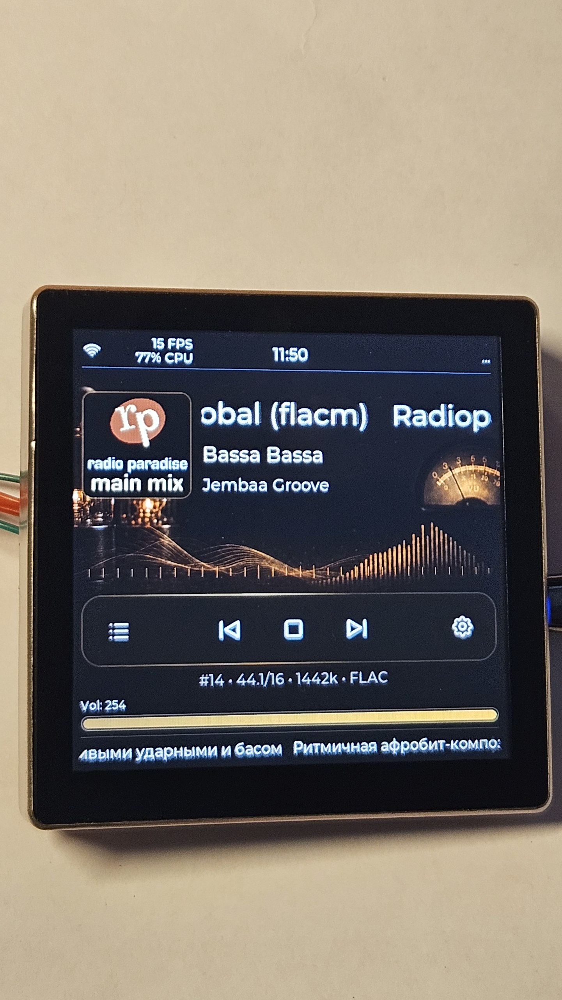

[Назад к README.md](README.md) — [English version](README_4848S040_english.md)

# ESP32-4848S040 — подключение и прошивка YoRadio

Аппаратная инструкция для ESP32-4848S040, поддерживаемой в публичной beta YoRadio LVGL: характеристики, звук, конфигурация, готовые бинарники и особенности подключения. Описание интерфейса, тем и Web UI — в [основном README](README.md).

Стабильная версия на `main`: `0.9.434m-r2-lvgl-beta.3.01`. Исходники ветки `night_build`: `0.9.434m-r2-lvgl-beta.3.06` (строка `YOVERSION`, не GitHub Release). Готовые пакеты ниже — исторический комплект линии beta.3.

<p align="center">
  
</p>

## Характеристики платы

| Параметр | Значение |
|---|---|
| MCU | ESP32-S3-WROOM-1-N16R8 (240 MHz, 2 ядра) |
| Flash | 16 MB |
| PSRAM | 8 MB (Octal) |
| Дисплей | ST7701S, RGB Panel, 480×480 |
| Тачскрин | GT911 (I2C) |
| USB/питание | USB-C |
| Файловая система | LittleFS |

## Что понадобится

- Плата ESP32-4848S040.
- Кабель USB-C.
- Внешний I2S DAC или усилитель с I2S-входом (рекомендуется).
- Провода к заднему разъёму.
- Активная акустика или усилитель на выходе ЦАП.
- [PlatformIO](https://platformio.org/) — если собираете из исходников.

## Важное замечание об аудио

Конфигурация YoRadio LVGL для ESP32-4848S040 по умолчанию рассчитана на **внешний I2S ЦАП**, подключённый к заднему разъёму платы. Это основной рабочий вариант: штатный вывод — шина I2S (`DOUT`/`BCLK`/`LRCK`), и при подключении соответствующего ЦАП или усилителя тракт работает как стереофонический.

Встроенный монофонический аудиотракт платы **не является** вариантом вывода по умолчанию. Его можно задействовать перемычками **R21 / R22 / R23** для первоначальной проверки и настройки — например, чтобы убедиться в работоспособности платы до подключения внешнего ЦАП.

Схема подключения ЦАП на плате не менялась — ниже сохранены уже проверенные фотографии.

## Подключение внешнего ЦАП

Для внешнего ЦАП нужны линии:

| Сигнал | GPIO | Назначение |
|---|---|---|
| DATA (DOUT) | 40 | Данные I2S |
| BCLK | 1 | Bit Clock |
| LRCK / WS (LRC) | 2 | Word Select |
| GND | — | Общий провод |
| Питание | — | По требованиям ЦАП |

Все три сигнала — выходы ESP32 в режиме I2S master. DOUT подключается к входу DIN/DATA ЦАП, BCLK к BCK, LRC к LRCK/WS. Прошивка не использует вход данных I2S и не выводит MCLK: отдельного макроса MCLK нет.

Числа 40 / 1 / 2 — разводка заднего разъёма этой платы, а не список свободных GPIO. Для другой разводки в `src/myoptions.h` меняются только `I2S_DOUT`, `I2S_BCLK` и `I2S_LRC`. Это не Custom Wiring, и поля `BoardDefaults.audio` прошивка не применяет. Новые числа берите из схемы своего ЦАП. Сборка отвергнет совпадение с линиями дисплея или тача. Диапазон 22–37 и номера больше 48 у этих трёх макросов она не проверяет и не доказывает, что пин свободен от USB, BOOT или SD.

Соберите окружение `[env:4848S040]` и прошейте свой `firmware.bin`. Пакет из `build_bin/` правки `myoptions.h` не содержит. После старта Serial в блоке `[HARDWARE CONFIG]` печатает `i2s-dout`, `i2s-bclk` и `i2s-lrc`. Это значения, с которыми собрана прошивка. Успешный ответ драйвера I2S в этот лог не входит.

Подробности слоёв конфигурации: [src/src/platform/README.md](src/src/platform/README.md), [Board Contract](src/src/platform/board/README.md), [Display Contract](src/src/platform/display/README.md), [Touch Contract](src/src/platform/touch/README.md).

Задний разъём с линиями подключения:

<p align="center">
  
</p>

Перемычки встроенного моно-ЦАП (R21, R22, R23):

<p align="center">
  
</p>

Задняя сторона платы:

<p align="center">
  
</p>

Точные электрические детали конкретной ревизии платы уточняйте по её маркировке и схеме.

## Подготовка конфигурации

1. Откройте `src/myoptions.h`. Сборка читает этот файл через `src/src/core/options.h`. Отдельный шаблон копировать не нужно.
2. Задайте `L10N_LANGUAGE`: `RU`, `EN`, `PL` или `SK`.
3. В PlatformIO выберите окружение `[env:4848S040]`. Оно задаёт SoC, flash и PSRAM. Плату выбирает `YORADIO_BOARD` в `src/myoptions.h`.
4. Wi-Fi и список станций настраиваются при первом запуске и через Web UI / файлы в `data/`.

Подробности сборки из исходников, включая согласованный набор библиотек ESP-IDF, — в [основном README](README.md#замечание-для-сборки-из-исходников) и в `platformio.ini`.

## Другая разводка того же ST7701 и GT911

Заводские GPIO дисплея и тача записаны в [профиле платы](src/src/platform/board/profiles/esp32s3_4848s040/README.md). Чтобы перенести отдельные линии той же панели ST7701 480×480 и того же GT911:

1. В `src/myoptions.h` установите `YORADIO_CUSTOM_WIRING` в `1`.
2. Раскомментируйте только изменившиеся строки `DISP_*` или `TOUCH_*` и впишите GPIO своей платы.
3. Не задавайте `ST7701_*` и `TS_*`. Сборка остановится и назовёт имя `DISP_*` или `TOUCH_*`.

Неизменённые строки остаются заводскими. Custom Wiring не меняет контроллер, размер 480×480, timing панели и адрес GT911 `0x5D`. Линии RESX в списке нет: сброс панели должен оставаться неподключённым. `TOUCH_INT` не переключает тач в режим прерывания; поддерживается опрос. Сборка проверяет диапазон GPIO дисплея и тача и повтор одного GPIO среди дисплея, тача и трёх пинов I2S. Она не доказывает, что провод лежит верно, и не назначает свободный GPIO.

В Serial строка `wiring: custom` означает, что флаг включён. Печатается также `backlight-gpio`. Отдельные RGB, SDA и SCL в этом логе не печатаются.

## Готовые бинарники

Готовые пакеты линии beta.3 находятся в [build_bin/4848S040/](build_bin/4848S040/) и доступны для языков **RU**, **EN**, **PL** и **SK**. Это исторический комплект, не прошивка текущих исходников `night_build`. Контрольные суммы и точный commit исходников каждой сборки указаны в README соответствующей языковой папки. GitHub Release `beta.3.06` эти пакеты не являются.

В каждой языковой папке:

- `bootloader.bin`
- `partitions.bin`
- `boot_app0.bin`
- `firmware.bin`
- `littlefs.bin`

`firmware.bin` и `littlefs.bin` должны быть взяты из **одной** языковой папки.
LittleFS содержит Web UI, ресурсы и AI prompt соответствующего языка.

Полная прошивка выполняется комплектом из пяти файлов; подробная карта адресов,
настройки Espressif Flash Download Tool и актуальный скриншот приведены в
[build_bin/4848S040/README.md](build_bin/4848S040/README.md).

## Первый запуск

После включения YoRadio показывает загрузочный экран и пытается подключиться к сохранённой сети. Если сеть не настроена или недоступна, открывается Wi-Fi Setup / Recovery: сканирование, выбор сети, ввод пароля (для открытой сети не запрашивается) и сохранение. После сохранения устройство перезагружается и открывает Main.

Если Recovery остаётся без действий, поднимается точка доступа `yoRadioAP` (без пароля). Подключитесь к ней и продолжите настройку через Web UI по IP точки доступа.

## Интерфейс YoRadio

Описание экранов Main, Info, Visual, Station, Weather и Settings, а также Preset Temporary, Screensaver, Deep Sleep / TIMERS и Web UI находится в основном [README проекта](README.md#интерфейс).

## Особенности управления на ESP32-4848S040

На этой плате управление сенсорное; энкодер не подключён.

| Жест | Действие |
|---|---|
| Горизонтальный свайп | Переключение Info / Main / Visual / Station / Weather / Settings |
| Слайд по громкости на Main | Регулировка громкости |
| Вертикальный свайп на Station | Листание списка станций |
| Свайп вниз от верхнего края (Info / Main / Visual / Weather) | Открыть Preset Temporary |
| Короткое / долгое нажатие в Preset | Запустить станцию / сохранить текущую в слот |
| Касание в Screensaver | Выход из заставки |
| Короткое нажатие BOOT в Deep Sleep | Пробуждение устройства (см. раздел ниже) |

## Пробуждение из Deep Sleep

Режим Deep Sleep переводит плату в глубокий сон. Тачскрин GT911 не является источником пробуждения, но пробуждение по настраиваемому `WAKE_PIN` поддерживается; в штатной конфигурации это кнопка BOOT на GPIO0 с активным уровнем LOW.

Конфигурация по умолчанию (`src/myoptions.h`):

```cpp
#define WAKE_PIN      0     // штатная кнопка BOOT
#define WAKE_LEVEL    LOW   // BOOT замыкает GPIO0 на GND
```

Штатная кнопка **BOOT** сидит на **GPIO0** и при нажатии замыкает его на GND, поэтому пробуждение работает без дополнительной пайки и без внешней подтяжки — подтяжка уже есть на плате.

GPIO0 одновременно используется RGB-панелью как заводская линия R4 (`DISP_R4` в Custom Wiring). Имя `ST7701_R4` задавать нельзя: сборка его отвергает. Чтобы совмещение не мешало пробуждению, прошивка в самом начале `setup()` — до инициализации конфигурации и дисплея — вызывает `rtc_gpio_deinit()` и возвращает GPIO0 из режима RTC IO в обычный GPIO. В лог при этом выводится:

```text
[WAKE] cause=EXT0
[WAKE] pin=0 restored to digital GPIO
```

**Порядок работы:**

1. Войти в Deep Sleep: через Settings → TIMERS → DEEP SLEEP (кнопка `SLEEP NOW`, см. ниже), либо командой `deepsleep` по Telnet/Serial. Дождаться, пока экран и подсветка полностью погаснут.
2. Коротко нажать BOOT и сразу отпустить.
3. Плата загрузится обычным образом.

> **Внимание.** Не нажимайте BOOT при работающем дисплее: GPIO0 в этот момент передаёт данные RGB-панели.

> **Внимание.** Не удерживайте BOOT во время аппаратного Reset — GPIO0 является boot strapping-пином, и удержание его в LOW через Reset переводит чип в download mode вместо загрузки.

Reset и переподключение питания остаются запасными способами запуска. Значение `WAKE_PIN=255` полностью отключает пробуждение по GPIO (на RTC-таймер ниже это не влияет). На ESP32-4848S040 значение по умолчанию — кнопка BOOT/GPIO0. Этот текст не называет другой RTC GPIO свободным. `WAKE_PIN` может быть 255 либо RTC GPIO 0–21; активный уровень — LOW или HIGH. Сборка проверяет только этот диапазон.

Перед Deep Sleep прошивка штатно останавливает воспроизведение, сохраняет состояние, выключает дисплей и только затем переводит ESP32-S3 в сон.

### Страница TIMERS и относительное пробуждение

Общее описание таймеров Radio и Deep Sleep находится в [основном README](README.md#таймеры). Ниже — особенности, важные именно для ESP32-4848S040.

В Settings → TIMERS → `DEEP SLEEP`:

- `DEEP SLEEP AFTER` задаёт задержку до входа в глубокий сон;
- `WAKE AFTER SLEEP` — RTC-интервал, который отсчитывается только после фактического засыпания;
- Sleep 5 MIN + Wake 3 MIN означает: через 5 минут плата уснёт, а примерно через 3 минуты после этого проснётся;
- если Sleep выключен, а Wake включён, отображается `WAKE AFTER NEXT SLEEP`: отсчёт ещё не идёт, пресет применится к следующему `SLEEP NOW` или команде `deepsleep`;
- BOOT и RTC-таймер могут быть разрешены одновременно — срабатывает первый источник;
- абсолютное расписание `HH:MM` не реализовано;
- если локальные часы ещё не синхронизированы (`CLOCK NOT SYNCED`), относительные таймеры всё равно продолжают работать.

Для обычного использования эти команды не нужны; они предназначены для дополнительного управления через Telnet/Serial.

| Команда Telnet / Serial | Действие |
|---|---|
| `sleeptimer N` / `sleeptimer 0` | Поставить / отменить Radio Stop через `N` минут; UI-пресет не меняется |
| `playtimer N` / `playtimer 0` | Поставить / отменить Radio Start через `N` минут |
| `deepsleep` | Немедленный Deep Sleep с сохранённым `WAKE AFTER SLEEP` |
| `deepsleep N` / `deepsleep 0` | Поставить / отменить Deep Sleep через `N` минут |
| `sleep N` | Совместимость со старым CLI: немедленный Deep Sleep с разовым wake через `N` минут |
| `sleep N M` | Совместимость со старым CLI: Deep Sleep через `M` минут и разовый wake через `N` минут после входа |

Команды работают через Serial и Telnet. Допустимый диапазон — 0…1499 минут, где применимо. Разовый wake-интервал совместимой старой команды `sleep` не перезаписывает сохранённый пресет `WAKE AFTER SLEEP`.

## Справочная таблица GPIO

Заводская разводка ESP32-4848S040. Полная карта линий дисплея и тача — в [профиле платы](src/src/platform/board/profiles/esp32s3_4848s040/README.md). Живые пины ЦАП и пробуждения — макросы в `src/myoptions.h`.

| Назначение | GPIO |
|---|---|
| Дисплей: CS / SCK / SDA (SWSPI) | 39 / 48 / 47 |
| Дисплей: DE / VSYNC / HSYNC / PCLK | 18 / 17 / 16 / 21 |
| Дисплей: данные R0–R4, G0–G5, B0–B4 | 16-битная RGB-шина, заводские номера в [профиле платы](src/src/platform/board/profiles/esp32s3_4848s040/README.md) |
| Подсветка (PWM) | 38 |
| Тачскрин GT911: SDA / SCL | 19 / 45 |
| I2S: DATA / BCLK / LRCK | 40 / 1 / 2 |
| Кнопка BOOT / пробуждение из Deep Sleep (`WAKE_PIN`, активный LOW) | 0 — совмещён с заводской линией R4 |
| Физическая кнопка MUTE (`BTN_MUTE`, опционально) | 255 — не задействована по умолчанию |
| Выход MUTE/enable усилителя (`MUTE_PIN`, опционально) | 255 — не задействован по умолчанию |

Пины SD (CS=42, SCK=48, MISO=41, MOSI=47) в этой конфигурации не используются: воспроизведение с SD в публичной beta отключено.

**MUTE.** `BTN_MUTE` — опциональная физическая кнопка на GND с внутренней подтяжкой. `MUTE_PIN` — независимый опциональный GPIO-выход для mute/enable внешнего усилителя (не тот же сигнал, что кнопка). Обе линии по умолчанию отключены (`255`) на ESP32-4848S040. Если усилитель требует аппаратный mute/enable, задайте GPIO в `src/myoptions.h`. Сборка не проверяет, пересекается ли этот GPIO с дисплеем, тачем, I2S, USB, BOOT или SD. Сверяйте номер с картой профиля и со своей схемой. Этот текст не назначает свободный GPIO.

## Завершение

- Основной README проекта → [README.md](README.md).
- Вопросы и ошибки → [Issues](https://github.com/Witaliy76/Yoradio_lvgl/issues).
- Автор адаптации: [Witaliy76](https://github.com/Witaliy76).
- Лицензия: GNU General Public License v3 or later — [LICENSE](LICENSE).
